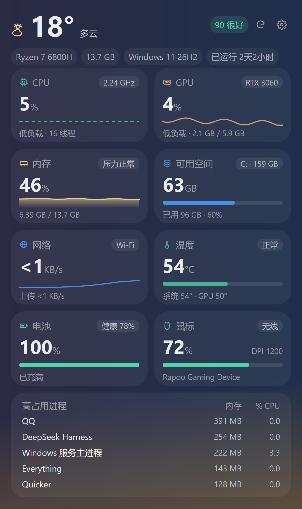

# SeeAll

竖版托盘面板，用来监视**万物**：现在自带鼠标电量和本机状态，多一种监控对象只是多一个插件。

用 [MyGo](https://mygo.egoist.dev/) 重写，原生 UI 直接画在 GPU 上：没有 webview、没有前端构建，一个 Go 二进制。



## 理念：一切皆插件

面板把所有监控项画在同一页上：每个读数一块，值、说明和刷新时间都在那一块里。

新增一种「可以监视的东西」= 写一个实现 `plugin.Plugin` 的包，放进 `internal/app/builtin.go` 的切片里。
设置页、持久化、托盘全都自动出现，不需要改 UI；面板上还会自动多一张设备卡。监控项本身就是内置的，不用添加也不用移除。

自带两个插件：

| 插件 | 监视什么 | 状态 |
| --- | --- | --- |
| 鼠标 | 雷柏 2.4G 鼠标的电量、连接方式、DPI（读状态广播帧），接收器自动识别、设备名取自它的产品字符串 | 已在真实硬件上验证 |
| 本机 | CPU 占用与频率、内存、电池（电量与健康度）、网络速率与出口类型、GPU 占用、显存、系统温度、系统盘剩余空间、开机时长、内存占用最高的几个程序，以及左上角的**天气**；显卡可在设置里挑 | 可用（GPU/显存/CPU 频率/温度走 Windows 性能计数器，进程走 Toolhelp32，天气走 Open-Meteo） |

## 用法

```powershell
go tool mygo build        # 打包：build/windows-amd64/SeeAll.exe + 安装包
go tool mygo dev          # 开发模式，改 .go 文件自动重启
go build -o seeall.exe .  # 快速编译（带控制台，会自动隐藏）
```

已经打好的产物：

| 文件 | 用途 |
| --- | --- |
| `SeeAll.exe`（仓库根目录） | 双击即用，免安装 |
| `build/windows-amd64/SeeAll.exe` | 同上，打包目录里的原件 |
| `build/windows-amd64/SeeAll Setup 1.0.0 amd64.exe` | 安装包：开始菜单、卸载项、开机自启 |

> **关于终端窗口**：`go build` 默认产出控制台程序，双击会带一个黑窗口。
> SeeAll 启动时会把**只属于自己的**那个控制台藏起来（`internal/console`）；
> 如果是从 cmd / PowerShell 起的，控制台是 shell 的，就不动它。
> `go tool mygo build` 打出来的 exe 加了 `-H=windowsgui`，本来就没有控制台。

- 左键托盘图标开关面板，右键是监控项菜单（刷新、设置、打开日志、退出都在那里）。
- 首次运行会打开面板，并把开机自启打开（设置页可关）。
- **配置和日志就在 exe 旁边**：`seeall.json` 与 `logs\seeall.log` 跟 `SeeAll.exe`
  同一个目录。整个应用就是一个文件夹，拷走、备份、删掉都是一件事。安装包装在
  `%LOCALAPPDATA%\Programs\SeeAll`，那是你自己的目录，写权限没问题。
  从旧版升级时，`%AppData%\SeeAll\seeall.json` 会被接管一次（读到后改名成
  `.migrated`），各插件的设置与不透明度都跟着过来。
  日志只记真正失败的事（找不到电量通道、性能计数器缺失、选中的显卡不在了），同一问题只记一次。
- **鼠标接收器自动识别**：按接收器广播状态帧的那个 HID collection 找它，插上就能读，设置页里没有要填的厂商号。
  认的是这个 collection（usage page `0xFF00` / usage `0x0002`），不是某家的 VID——换一个说同一套协议的品牌照样能用，
  说别的协议的 collection 发不出这种帧，解析器那一关就过去了。
- **监控项是内置的，自动出现**：配置文件和设置页都不再管「加一个、删一个」——插件装好就在面板上，
  设置页里只有它自己的那几项设置。
- 多显卡的机器可以在设置里选监控哪一张（默认「自动」= 显存最大的那张），页面上的 GPU 和显存只统计它。
- 设置里的「不透明度」滑块把面板调淡（最低 40%），拖动时窗口实时跟着变，松手才写入配置文件的 `ui.opacity`。
- 面板不发系统通知：电量低这类事情自己看面板，别在右下角再弹一个。

快捷键：`Ctrl+R` 或 `F5` 刷新全部，`Esc` 收起面板。

## 面板

面板停在**屏幕右下角**，离边缘和任务栏各留 8 **像素**，像一块浮起来的卡片，而不是焊在任务栏上。位置由 `tray.Inset` + `tray.Dock` 算：工作区（本身已排除任务栏）先内缩边距，再右下对齐；换显示器或改缩放会重算。

面板是**一列竖版，尺寸是 660×1110 物理像素**——设计稿的单位，不是 DIP。窗口按显示器的缩放换算成 DIP 去要尺寸：

```go
const DesignWidth, DesignHeight = 660, 1110  // 像素
Width  = round(660 / scale)                  // DIP：1x→660，1.5x→440，2x→330
```

这样它在任何缩放比例下都占同样多的屏幕像素，150% 的笔记本上正好是 **440×740 DIP**——内容量出来约 728 DIP，一屏放得下，不用滚：

| 屏幕 | 窗口（DIP） | 实际占用 |
| --- | --- | --- |
| 2560×1440 @150%（工作区 1706×960 DIP） | 440 × 740 | 660 × 1110 px，一屏 |
| 1920×1080 @100% | 618 × 1040 | 618 × 1040 px（高度放到工作区，宽度等比缩） |
| 4K @200% | 330 × 555 | 660 × 1110 px（窗口矮，内容滚动） |

放不下（工作区比它小）时按高度等比缩，宽度再兜一次底；屏幕再大也不跟着长——托盘面板不该铺满屏幕。

尺寸一次算定，关掉重开都不变；内容装不下时页内滚动。`fit_test.go` 钉着「像素换算成 DIP」这件容易写反的事（150% 下 660×1110 px 必须等于 440×740 DIP），`dashboard_test.go` 在 660×1110、440×740 和小屏三种窗口下渲染整页，断言所有内容都在窗口内、不用滚——卡高一改就红。

### 面板长什么样

一整块深蓝渐变画布，底部透一层暖光；**一页**，不按监控项分页。

- **头**：左边是这台机器在的地方的**天气**——今天的形状（太阳 / 太阳带云 / 阴 / 雾 / 雨 / 雪 / 雷）、温度和一个词（晴、多云、小雨……），鼠标停上去说这是哪座城市、几点取的；健康分退成右上角一个小胶囊（`90 很好`），挨着刷新和设置两个图标按钮。分数认不出天气时才回到左边当主角。下面一排胶囊写这台机器**是什么**：CPU 型号、内存总量、Windows 版本、已运行多久。点齿轮进设置，设置页左上角「‹ 返回」回来。
- **卡片**：每张一样大，两列——CPU、GPU、内存、可用空间、网络、温度，然后是电池和鼠标。每张是「图标 + 标题 … 徽标 / 大数字 + 单位 / 一条折线或进度条 / 一行说明」：
  - 徽标写数字说不出来的那半句：CPU 是频率，GPU 是**型号**，内存是压力档，磁盘是卷标，网络是出口类型，温度是正常与否，电池是健康度，鼠标是连接方式。
  - 形状按读数定：CPU、GPU、网络是折线，内存是面积，磁盘、温度、电量是进度条。
  - 鼠标那张卡：电量右边是 DPI，说明行只写设备名（`Rapoo Gaming Device`）；掉线时卡还在，数字写「—」、徽标写「未连接」。
  - 显存并进 GPU 的说明行，开机时长只出现在胶囊里。
  - 放不下时收尾而不是溢出：胶囊里的字和徽标上的型号到了宽度就截断成「…」（型号按词收尾，`RTX 3060 Laptop` 显示成 `RTX 3060…`），不会画到隔壁胶囊或卡片边缘上。
- **进程**：高占用进程按内存取前 5，同名的进程合成一行（浏览器十几个进程算一个程序），受保护进程打不开就跳过。

健康分在插件里算：CPU、内存、GPU、温度、磁盘、电池各有一段免罚区间，超出才扣分，读不到的维度不扣（没电池的台式机不该因为没电池而低分）。温度是让一台闲置机器落在 90 上下而不是 100 的原因。

天气不是机器自己的事，所以单独放在 `internal/weather`：先问 `myip.ipip.net` 这台机器在哪个城市（它回答「中国 重庆 重庆」这种），把城市名交给 Open-Meteo 的 geocoding 换经纬度，再问 Open-Meteo 的 `current` 要温度和 WMO 天气码。两个服务都不用注册、不用 key，也都可以失败——所以**拿不到就不显示**，左边退回健康分：一个旧的温度比没有更糟。十五分钟问一次，点刷新会立刻再问；连续失败时日志只写一行，不刷屏。最后一次成功超过 45 分钟也按没有处理（笔记本合盖睡一夜，醒来不该显示昨晚的温度）。IP 定位认的是出口 IP，挂着全局代理时可能定位到代理落地的那座城市，这是这种定位方式自带的误差。

页面里没有状态栏，也没有日志和退出按钮：托盘右键菜单里两样都有，面板只管看。

文档图：[面板](docs/panel-dashboard.png) 和 [设置页](docs/panel-dashboard-settings.png)。

托盘图标按电量画环：数字居中、外面一圈按百分比点亮（>30% 青绿 / 11–30% 琥珀 / ≤10% 红；离线画灰环，没数据画三个点）。深浅色任务栏各用一套墨色。


## 结构

```
main.go                     进程入口：单实例、托盘、面板窗口、自启
internal/console/           藏掉自定义的控制台窗口（只有 Windows 有这问题）
internal/core/              读数模型：Reading / Snapshot / Fact / Process / Severity / 环形历史 / 单位格式化
internal/plugin/            插件契约：Plugin / Instance / Manifest / Env / Settings
internal/hid/               Windows HID 枚举与只读接收（无 cgo）；其他平台是空实现
internal/plugins/mouse/     雷柏 2.4G 协议（frame.go 里有逐字节的帧格式）
internal/plugins/system/    CPU / 内存 / 电池 / 网络 / 磁盘 / 温度 / GPU / 进程 / 开机时长（Windows 采样分文件）
internal/weather/           IP 定位 + Open-Meteo：机器所在城市的温度与天气码
internal/app/               宿主：设置落盘、实例生命周期、快照与历史
internal/panel/             面板视图（原生 UI，Go 写）
internal/tray/              托盘图标与面板定位
cmd/preview/                不用窗口把面板渲染成 PNG（文档图就是这么来的）
cmd/icon/                   生成 resources/icon.png
cmd/diag/                   HID 列设备与抓包（协议验证用）
AGENTS.md                   给 AI agent 的仓库说明（命令、坑、约定）
```

架构约定见 [docs/design.md](docs/design.md)。

## 诊断 HID

```powershell
go run ./cmd/diag -list                    # 列出所有 HID collection，* 标记电量通道
go run ./cmd/diag -capture -seconds 10     # 同时监听所有电量通道，逐帧打印并解析
```

雷柏的状态帧（7 字节，实测 VT9 PRO）：

```
BB B0 42 B0 04 01 5F
│  │  │  └─┬─┘ │  └─ 电量百分比 0..100
│  │  │    │   └──── 连接标志：0x01 无线 / 0x02 有线
│  │  │    └──────── 当前 DPI（u16 LE，本机唯一可信的 DPI 来源）
│  │  └───────────── 机型 / 通道标识
│  └──────────────── 帧类型：状态广播
└─────────────────── report ID
```

## 重新生成文档图

```powershell
go run ./cmd/preview -out docs      # 面板与设置页的 PNG
go run ./cmd/icon                   # 应用图标
go test ./internal/tray -run TestIconSheet   # .preview/probe-icons.png，托盘各状态
```

## 测试

```powershell
go test ./...
```

面板的布局测试挡着老项目踩过的坑：设置页必须从顶部开始（长内容靠滚动，不是把标题推出去）、整页一屏放得下（卡高一改就红）、卡片等宽等高、设备卡不掉、齿轮能进设置且「返回」回得来、窄屏胶囊不越界、放不下的胶囊和徽标在 440 DIP 下收尾而不是画到框外、天气在左时健康分退成胶囊且不挤进那排胶囊（四颗在 440 DIP 下正好满，第五颗就得裁字）。健康分的档位、进程的合并与排序、每条读数的徽标、天气码到文字与图形的映射各有单元测试。

## 已知边界

- **雷柏接收器没有读回通道**：除状态帧里的 DPI，写进去的参数没法确认。SeeAll 这一版只读不写，不显示任何「你以为写进去了」的状态。
- **只读这一套 HID 协议**：接收器自动识别的是 usage page `0xFF00` / usage `0x0002` 那个 collection，说的是别的协议的鼠标（比如各家厂商的私有驱动通道）没有这个 collection，面板上就没有它。
- HID 读取目前只有 Windows 实现；其他平台能编译，鼠标插件会报告没有通道。
- **温度只有 ACPI thermal zone**：那是机箱/主板级的读数，所以文案写「系统 59°」，不冒充 CPU 封装温度；GPU 温度 Windows 没有通用 API，读不到就不往 GPU 卡的说明行里写，也不编一个数字。
- **磁盘只统计系统盘**（`%SystemDrive%`，通常 C:），不是所有卷求和——本机那张「可用空间」卡问的就是这个盘。