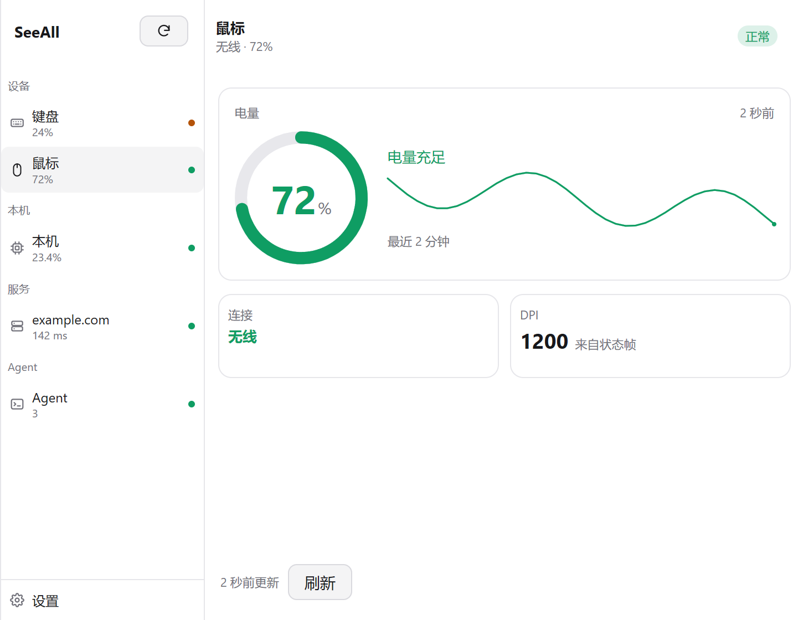

# SeeAll

托盘里的小面板，用来监视**万物**：鼠标和键盘的电量、本机 CPU 与内存、你盯着的服务器、这台机器上跑着的 AI 编码代理。

用 [MyGo](https://mygo.egoist.dev/) 重写，原生 UI 直接画在 GPU 上：没有 webview、没有前端构建，一个 Go 二进制。



## 理念：一切皆插件

面板对每个监控对象是同一块：左边列出监控项，右边是它的当前值、读数列表和刷新时间。

新增一种「可以监视的东西」= 写一个实现 `plugin.Plugin` 的包，放进 `internal/app/builtin.go` 的切片里。
列表、设置页、持久化、托盘、通知全都会自动出现，不需要改 UI。

自带五个插件：

| 插件 | 监视什么 | 状态 |
| --- | --- | --- |
| 鼠标 | 雷柏 2.4G 鼠标的电量、连接方式、DPI（读状态广播帧） | 已在真实硬件上验证 |
| 键盘 | 无线键盘电量：HID 电池字段，或雷柏状态帧 | 实验，协议已实现但未对着硬件验证 |
| 本机 | CPU、内存、磁盘剩余、电池、开机时长 | 可用 |
| 服务器 | HTTP 状态码、延迟趋势、证书剩余天数、连续失败次数 | 可用，可加多个 |
| Agent | 本机在跑的 AI 编码代理：数量、活动、运行时长 | 可用（只读进程表） |

## 用法

```powershell
go tool mygo build        # 打包：build/windows-amd64/SeeAll.exe + 安装包
go tool mygo dev          # 开发模式，改 .go 文件自动重启
go build -o seeall.exe .  # 快速编译（带控制台，会自动隐藏）
```

已经打好的产物：

| 文件 | 用途 |
| --- | --- |
| `SeeAll.exe`（仓库根目录） | 双击即用，免安装 |
| `build/windows-amd64/SeeAll.exe` | 同上，打包目录里的原件 |
| `build/windows-amd64/SeeAll Setup 2.0.0 amd64.exe` | 安装包：开始菜单、卸载项、开机自启 |

> **关于终端窗口**：`go build` 默认产出控制台程序，双击会带一个黑窗口。
> SeeAll 启动时会把**只属于自己的**那个控制台藏起来（`internal/console`）；
> 如果是从 cmd / PowerShell 起的，控制台是 shell 的，就不动它。
> `go tool mygo build` 打出来的 exe 加了 `-H=windowsgui`，本来就没有控制台。

- 左键托盘图标开关面板，右键是监控项菜单。
- 首次运行会打开面板，并把开机自启打开（设置页可关）。
- 配置在 `%AppData%\SeeAll\seeall.json`，日志在 `%AppData%\SeeAll\logs\seeall.log`。

快捷键：`Ctrl+R` 或 `F5` 刷新全部，`Esc` 收起面板。

## 面板

面板**贴着屏幕右边缘、坐在任务栏上方**，像系统自己的浮出面板：位置由 `tray.Dock` 按工作区算出来（工作区本身已经排除了任务栏），换显示器或改缩放会跟着重算。

尺寸不是写死的，按工作区算：

| 屏幕 | 面板 |
| --- | --- |
| 2560×1440 @150%（工作区 1706×912 DIP） | 716 × 560 DIP |
| 1920×1080 @100% | 806 × 624 DIP |
| 1366×768 笔记本 | 573 × 560 DIP |

规则是「工作区宽的 42%，高的 58%，夹在 560–920 宽、560–680 高之间」——桌面显示器得到能并排放两张读数卡的面板，笔记本小一些。

尺寸一次算定，切页/关掉重开都不变；内容装不下时页内滚动。`internal/panel/fit_test.go` 会把每个页面按桌面和笔记本两种尺寸渲染一遍，检查页脚没被裁掉。

详情页是仪表盘：主读数一张大卡（环 + 趋势），其余读数两张一行的小卡；设置页是长表单，滚动。

托盘图标按电量画环：数字居中、外面一圈按百分比点亮（>30% 青绿 / 11–30% 琥珀 / ≤10% 红；离线画灰环，没数据画三个点）。深浅色任务栏各用一套墨色。


## 结构

```
main.go                     进程入口：单实例、托盘、面板窗口、自启
internal/console/           藏掉自定义的控制台窗口（只有 Windows 有这问题）
internal/core/              读数模型：Reading / Snapshot / Severity / 环形历史 / 单位格式化
internal/plugin/            插件契约：Plugin / Instance / Manifest / Env / Settings
internal/hid/               Windows HID 枚举与只读接收（无 cgo）；其他平台是空实现
internal/plugins/mouse/     雷柏 2.4G 协议（frame.go 里有逐字节的帧格式）
internal/plugins/keyboard/  键盘电量
internal/plugins/system/    CPU / 内存 / 磁盘 / 电池 / 开机时长
internal/plugins/server/    HTTP 探活
internal/plugins/agent/     代理进程发现
internal/app/               宿主：设置落盘、实例生命周期、通知
internal/panel/             面板视图（原生 UI，Go 写）
internal/tray/              托盘图标与面板定位
cmd/preview/                不用窗口把各页渲染成 PNG（文档图就是这么来的）
cmd/icon/                   生成 resources/icon.png
cmd/diag/                   HID 列设备与抓包（协议验证用）
tools/shot.ps1              截活动窗口（开发核对用）
```

架构约定见 [docs/design.md](docs/design.md)。

## 诊断 HID

```powershell
go run ./cmd/diag -list                    # 列出所有 HID collection，* 标记电量通道
go run ./cmd/diag -capture -seconds 10     # 同时监听所有电量通道，逐帧打印并解析
```

雷柏的状态帧（7 字节，实测 VT9 PRO）：

```
BB B0 42 B0 04 01 5F
│  │  │  └─┬─┘ │  └─ 电量百分比 0..100
│  │  │    │   └──── 连接标志：0x01 无线 / 0x02 有线
│  │  │    └──────── 当前 DPI（u16 LE，本机唯一可信的 DPI 来源）
│  │  └───────────── 机型 / 通道标识
│  └──────────────── 帧类型：状态广播
└─────────────────── report ID
```

## 重新生成文档图

```powershell
go run ./cmd/preview -out docs      # 各页的 PNG
go run ./cmd/icon                   # 应用图标
go test ./internal/tray -run TestIconSheet   # .preview/probe-icons.png，托盘各状态
```

## 测试

```powershell
go test ./...
```

面板的三个布局测试挡着老项目踩过的坑：设置页必须从顶部开始（长内容靠滚动，不是把标题推出去）、详情页要用插件指定的主读数、点侧栏能切页。

## 已知边界

- **雷柏接收器没有读回通道**：除状态帧里的 DPI，写进去的参数没法确认。SeeAll 这一版只读不写，不显示任何「你以为写进去了」的状态。
- 键盘插件标着「实验」：两条读取路径都实现了，但没对着真实键盘验证过。
- HID 读取目前只有 Windows 实现；其他平台能编译，设备类插件会报告没有通道。
- Agent 插件只读进程表，不读对话内容和文件。