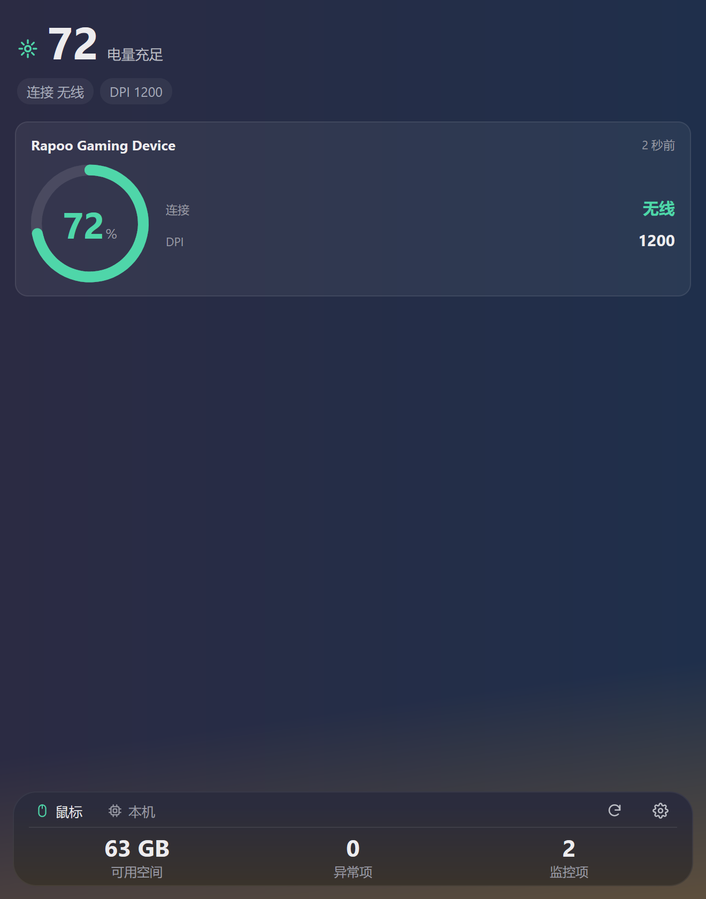

# SeeAll

竖版托盘面板，用来监视**万物**：现在自带鼠标电量和本机状态，多一种监控对象只是多一个插件。

用 [MyGo](https://mygo.egoist.dev/) 重写，原生 UI 直接画在 GPU 上：没有 webview、没有前端构建，一个 Go 二进制。


## 理念：一切皆插件

面板对每个监控对象是同一块：一排标签选监控项（仪表盘在页脚，经典在顶部），下面是它的当前值、读数列表和刷新时间。

新增一种「可以监视的东西」= 写一个实现 `plugin.Plugin` 的包，放进 `internal/app/builtin.go` 的切片里。
列表、设置页、持久化、托盘、通知全都会自动出现，不需要改 UI。

自带两个插件：

| 插件 | 监视什么 | 状态 |
| --- | --- | --- |
| 鼠标 | 雷柏 2.4G 鼠标的电量、连接方式、DPI（读状态广播帧），设备名取自接收器的产品字符串 | 已在真实硬件上验证 |
| 本机 | CPU 占用与频率、内存、电池（电量与健康度）、网络速率与出口类型、GPU 占用、显存、系统温度、系统盘剩余空间、开机时长、内存占用最高的几个程序；显卡可在设置里挑 | 可用（GPU/显存/CPU 频率/温度走 Windows 性能计数器，进程走 Toolhelp32） |

## 用法

```powershell
go tool mygo build        # 打包：build/windows-amd64/SeeAll.exe + 安装包
go tool mygo dev          # 开发模式，改 .go 文件自动重启
go build -o seeall.exe .  # 快速编译（带控制台，会自动隐藏）
```

已经打好的产物：

| 文件 | 用途 |
| --- | --- |
| `SeeAll.exe`（仓库根目录） | 双击即用，免安装 |
| `build/windows-amd64/SeeAll.exe` | 同上，打包目录里的原件 |
| `build/windows-amd64/SeeAll Setup 1.0.0 amd64.exe` | 安装包：开始菜单、卸载项、开机自启 |

> **关于终端窗口**：`go build` 默认产出控制台程序，双击会带一个黑窗口。
> SeeAll 启动时会把**只属于自己的**那个控制台藏起来（`internal/console`）；
> 如果是从 cmd / PowerShell 起的，控制台是 shell 的，就不动它。
> `go tool mygo build` 打出来的 exe 加了 `-H=windowsgui`，本来就没有控制台。

- 左键托盘图标开关面板，右键是监控项菜单（刷新、设置、打开日志、退出都在那里）。
- 首次运行会打开面板，并把开机自启打开（设置页可关）。
- **配置和日志就在 exe 旁边**：`seeall.json` 与 `logs\seeall.log` 跟 `SeeAll.exe`
  同一个目录。整个应用就是一个文件夹，拷走、备份、删掉都是一件事。安装包装在
  `%LOCALAPPDATA%\Programs\SeeAll`，那是你自己的目录，写权限没问题。
  从旧版升级时，`%AppData%\SeeAll\seeall.json` 会被接管一次（读到后改名成
  `.migrated`），监控项、卡片顺序、不透明度都跟着过来。
  日志只记真正失败的事（找不到电量通道、性能计数器缺失、选中的显卡不在了），同一问题只记一次。
- 设置页可以移除监控项；移除的那一项用「添加」加回来，设置照旧（移除时的取值存在配置文件的 `removed` 里）。
- 多显卡的机器可以在设置里选监控哪一张（默认「自动」= 显存最大的那张），页面上的 GPU 和显存只统计它。
- 每个读数卡片都能拖着换位置，顺序按监控项存进配置文件的 `order`，关掉重开还在。
- 设置里的「不透明度」滑块把面板调淡（最低 40%），拖动时窗口实时跟着变，松手才写入配置文件的 `ui.opacity`。
- 设置里的「通知」是总开关（`ui.notify`）：关掉之后任何监控项都不再弹通知。各插件自己的「提醒」开关决定它什么情况下想通知，两个都开才会弹。
- 设置里的「主题」切换面板外观（`ui.theme`）：默认「深蓝仪表盘」，也可以换回「经典」。切换立刻生效，不用重启。

快捷键：`Ctrl+R` 或 `F5` 刷新全部，`Esc` 收起面板。

## 面板

面板停在**屏幕右下角**，离边缘和任务栏各留 8 **像素**，像一块浮起来的卡片，而不是焊在任务栏上。位置由 `tray.Inset` + `tray.Dock` 算：工作区（本身已排除任务栏）先内缩边距，再右下对齐；换显示器或改缩放会重算。

面板是**一列竖版，尺寸是 660×840 物理像素**——设计稿的单位，不是 DIP。窗口按显示器的缩放换算成 DIP 去要尺寸：

```go
const DesignWidth, DesignHeight = 660, 840   // 像素
Width  = round(660 / scale)                  // DIP：1x→660，1.5x→440，2x→330
```

这样它在任何缩放比例下都占同样多的屏幕像素：

| 屏幕 | 窗口（DIP） | 实际占用 |
| --- | --- | --- |
| 2560×1440 @150%（工作区 1706×912 DIP） | 440 × 560 | 660 × 840 px |
| 1920×1080 @100% | 660 × 840 | 660 × 840 px |
| 4K @200% | 330 × 420 | 660 × 840 px |

放不下（工作区比它小）时按高度等比缩，宽度再兜一次底；屏幕再大也不跟着长——托盘面板不该铺满屏幕。

尺寸一次算定，切页/关掉重开都不变；内容装不下时页内滚动。`internal/panel/fit_test.go` 把经典外观的每个页面按桌面和笔记本两种尺寸渲染一遍，检查标题栏、标签页、页面三层的相对位置和边界；`dashboard_test.go` 对仪表盘做同样的事（头、卡片、底栏都在窗口内，底栏不压内容，窄屏胶囊不越界）；另外三条测试盯着「像素换算成 DIP」这件容易写反的事（150% 下 660×840 px 必须等于 440×560 DIP）。

### 两种外观

设置页「主题」里切，默认**深蓝仪表盘**：一整块深蓝渐变画布，底部透一层暖光。

- **头**：一个太阳、一个 0–100 的健康分和一句评语（很好 / 良好 / 一般 / 需要处理），下面一排胶囊写这台机器**是什么**：CPU 型号、内存总量、Windows 版本、已运行多久。
- **卡片**：六个部件两列——CPU、GPU、内存、可用空间、网络、温度。每张卡是「图标 + 标题 … 徽标 / 大数字 + 单位 / 一条折线或进度条 / 一行说明」，徽标写数字说不出来的那半句：频率、温度、压力档、卷标、出口类型、正常与否。电池单独一张整宽卡；显存并进 GPU 的说明行，开机时长只出现在胶囊里。
- **进程**：高占用进程按内存取前 5，同名的进程合成一行（浏览器十几个进程算一个程序），受保护进程打不开就跳过。
- **底栏**：固定在页脚、不跟内容滚——监控项标签、刷新、设置、一条分隔线，三列统计：可用空间 / 异常项 / 监控项。统计是整个窗口的，切到鼠标页也还在。

健康分在插件里算：CPU、内存、GPU、温度、磁盘、电池各有一段免罚区间，超出才扣分，读不到的维度不扣（没电池的台式机不该因为没电池而低分）。温度是让一台闲置机器落在 90 上下而不是 100 的原因。

设备页没有这些部件：鼠标就用同一块画布和页头显示「72 电量充足」，下面还是那张合卡。设置页控件一个不少，只是换成深色。



窄窗口（150% 缩放下是 440×560）里两条列会变窄，内容超出一屏的部分在头和底栏之间滚动——头和底栏是钉住的。

**经典**外观是换皮肤前的样子，`docs/panel-system.png` 里那套：标题栏 + 标签页 + 读数卡。从上到下三层：

- **标题栏**：应用名 + 刷新 + 设置。
- **标签页**：每个监控项一个，等宽铺满，选中项是白底描边的卡片；状态不是「正常」时标签上是彩点，因为一次只看得到一页。
- **页面**：每个读数一张同样大小的卡，两张一行；卡里标签在左上、趋势折线在右上、值在中间、说明在下面。插件标出的主读数排第一张，值用大一号的字号。插件声明 `Combined` 时整页只有一张卡：设备名横在顶部，左边是电量环，右边是连接与 DPI 各占一行（鼠标就是这样——电量、连接、DPI 是同一只鼠标的三件事）。合卡页不画折线，也不写「电量充足」这类说明，环和数字已经说完了。读数多了整页滚动。卡片可以拖着重排，插件后来新增的读数接在排过的后面。

页面里没有状态栏，也没有日志和退出按钮：托盘右键菜单里两样都有，面板只管看。

两套外观的文档图在 `docs/` 里：[仪表盘本机页](docs/panel-dashboard.png)、
[仪表盘鼠标页](docs/panel-dashboard-mouse.png)、[仪表盘设置页](docs/panel-dashboard-settings.png)，
经典的 [本机页](docs/panel-system.png)、[鼠标页](docs/panel-mouse.png)、[设置页](docs/panel-settings.png)。

托盘图标按电量画环：数字居中、外面一圈按百分比点亮（>30% 青绿 / 11–30% 琥珀 / ≤10% 红；离线画灰环，没数据画三个点）。深浅色任务栏各用一套墨色。


## 结构

```
main.go                     进程入口：单实例、托盘、面板窗口、自启
internal/console/           藏掉自定义的控制台窗口（只有 Windows 有这问题）
internal/core/              读数模型：Reading / Snapshot / Fact / Process / Severity / 环形历史 / 单位格式化
internal/plugin/            插件契约：Plugin / Instance / Manifest / Env / Settings
internal/hid/               Windows HID 枚举与只读接收（无 cgo）；其他平台是空实现
internal/plugins/mouse/     雷柏 2.4G 协议（frame.go 里有逐字节的帧格式）
internal/plugins/system/    CPU / 内存 / 电池 / 网络 / 磁盘 / 温度 / GPU / 进程 / 开机时长（Windows 采样分文件）
internal/app/               宿主：设置落盘、实例生命周期、通知、主题
internal/panel/             面板视图（原生 UI，Go 写）：经典与仪表盘两套外观
internal/tray/              托盘图标与面板定位
cmd/preview/                不用窗口把各页渲染成 PNG（文档图就是这么来的）
cmd/icon/                   生成 resources/icon.png
cmd/diag/                   HID 列设备与抓包（协议验证用）
AGENTS.md                   给 AI agent 的仓库说明（命令、坑、约定）
```

架构约定见 [docs/design.md](docs/design.md)。

## 诊断 HID

```powershell
go run ./cmd/diag -list                    # 列出所有 HID collection，* 标记电量通道
go run ./cmd/diag -capture -seconds 10     # 同时监听所有电量通道，逐帧打印并解析
```

雷柏的状态帧（7 字节，实测 VT9 PRO）：

```
BB B0 42 B0 04 01 5F
│  │  │  └─┬─┘ │  └─ 电量百分比 0..100
│  │  │    │   └──── 连接标志：0x01 无线 / 0x02 有线
│  │  │    └──────── 当前 DPI（u16 LE，本机唯一可信的 DPI 来源）
│  │  └───────────── 机型 / 通道标识
│  └──────────────── 帧类型：状态广播
└─────────────────── report ID
```

## 重新生成文档图

```powershell
go run ./cmd/preview -out docs      # 各页的 PNG
go run ./cmd/icon                   # 应用图标
go test ./internal/tray -run TestIconSheet   # .preview/probe-icons.png，托盘各状态
```

## 测试

```powershell
go test ./...
```

面板的布局测试挡着老项目踩过的坑：设置页必须从顶部开始（长内容靠滚动，不是把标题推出去）、详情页要用插件指定的主读数、点标签能切页；仪表盘那组还盯着底栏不压内容、窄屏胶囊不越界。健康分的档位、进程的合并与排序、每条读数的徽标各有单元测试。

## 已知边界

- **雷柏接收器没有读回通道**：除状态帧里的 DPI，写进去的参数没法确认。SeeAll 这一版只读不写，不显示任何「你以为写进去了」的状态。
- HID 读取目前只有 Windows 实现；其他平台能编译，鼠标插件会报告没有通道。
- **温度只有 ACPI thermal zone**：那是机箱/主板级的读数，所以文案写「系统 59°」，不冒充 CPU 封装温度；GPU 温度 Windows 没有通用 API，读不到就不显示那个徽标，也不编一个数字。
- **磁盘只统计系统盘**（`%SystemDrive%`，通常 C:），不是所有卷求和——底栏那格「可用空间」问的是同一个盘。